# SMART Inventory Management Platform

> Multi-tenant SaaS inventory management for Producers/Importers and Retailers/Distributors.
> One codebase, two personas — differentiated entirely by `organisation_type` on the tenant record.

---

## Table of Contents

- [Architecture Overview](#architecture-overview)
- [System Components](#system-components)
- [Transactional Outbox Pattern](#transactional-outbox-pattern)
- [Permission System (RBAC + ABAC)](#permission-system-rbac--abac)
- [Inventory Ledger](#inventory-ledger)
- [Dispatch Strategy Engine](#dispatch-strategy-engine)
- [Workflow State Machines](#workflow-state-machines)
- [Offline Sync Strategy](#offline-sync-strategy)
- [Deployment Pipeline](#deployment-pipeline)
- [Repository Structure](#repository-structure)
- [Phase Roadmap](#phase-roadmap)
- [Tech Stack](#tech-stack)
- [Getting Started](#getting-started)

---

## Architecture Overview

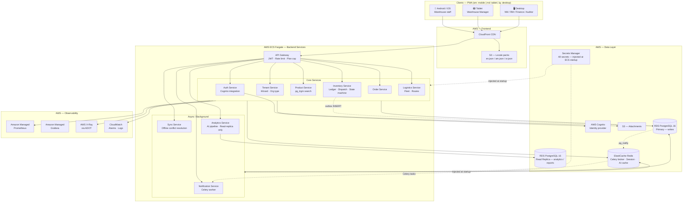

---

## System Components

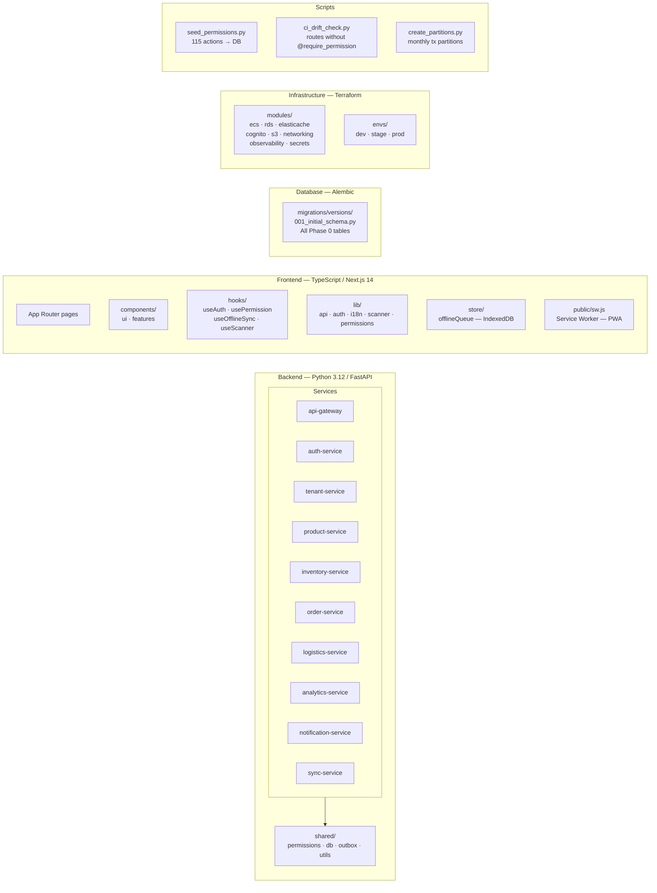

---

## Transactional Outbox Pattern

> Replaces Apache Kafka. Zero new infrastructure — atomic with every business transaction.

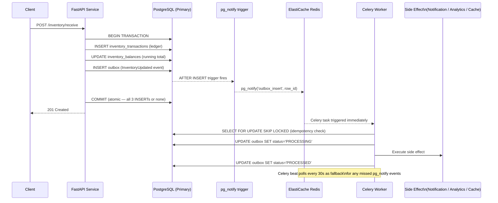

---

## Permission System (RBAC + ABAC)

> Three mandatory layers — all three must pass. UI hiding is NOT a security layer.

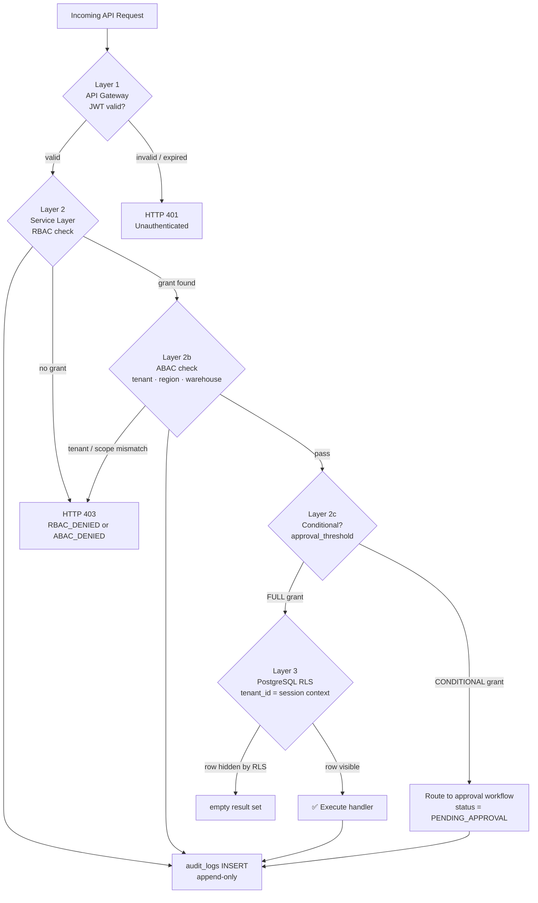

**Role hierarchy (highest → lowest):**

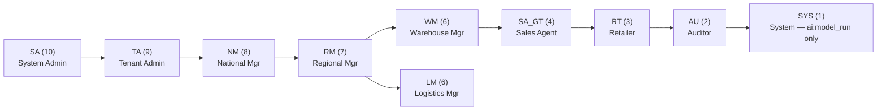

---

## Inventory Ledger

> Immutable by design — stock balance is always derived from the ledger, never stored directly.

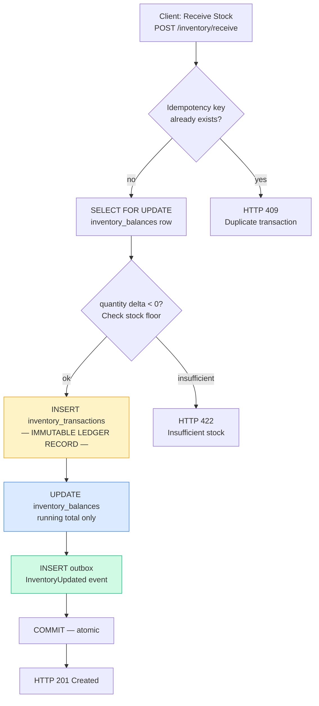

---

## Dispatch Strategy Engine

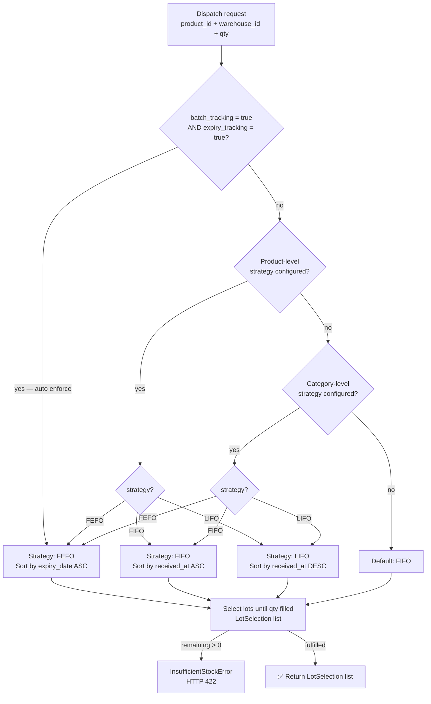

---

## Workflow State Machines

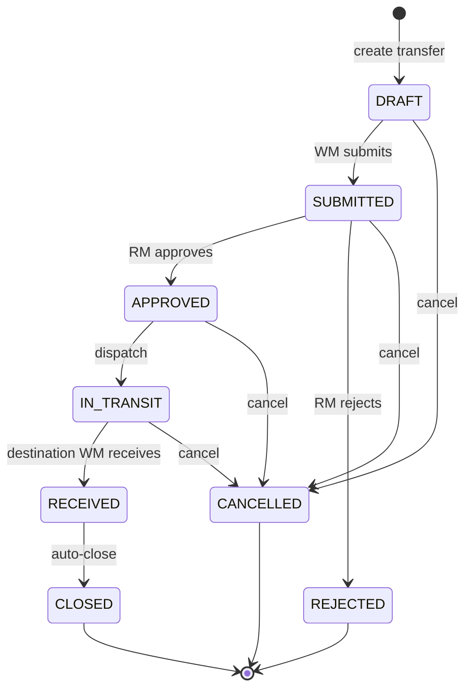

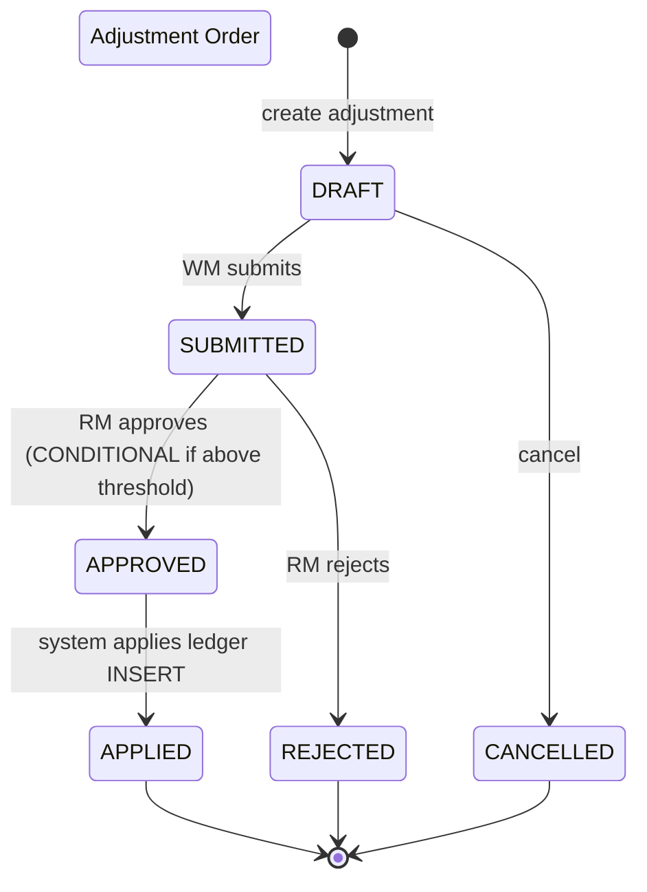

---

## Offline Sync Strategy

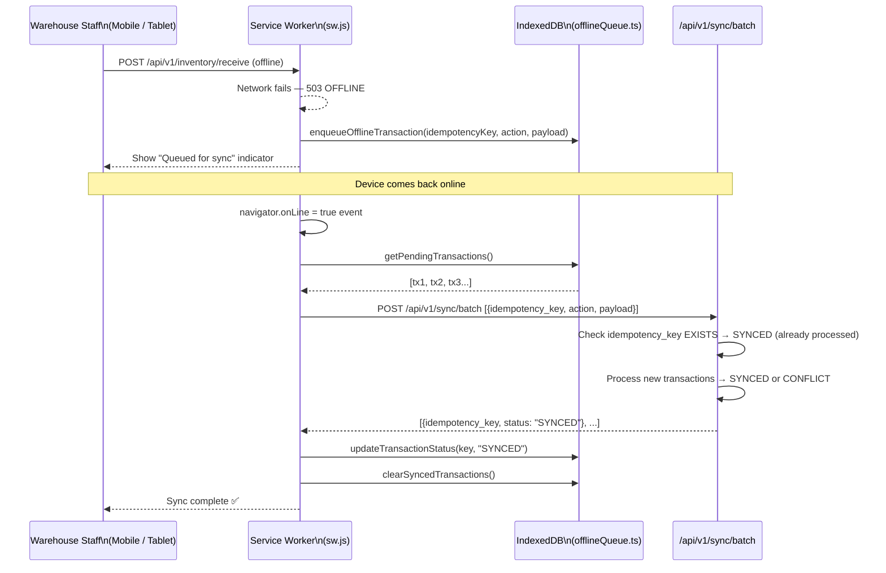

---

## Deployment Pipeline

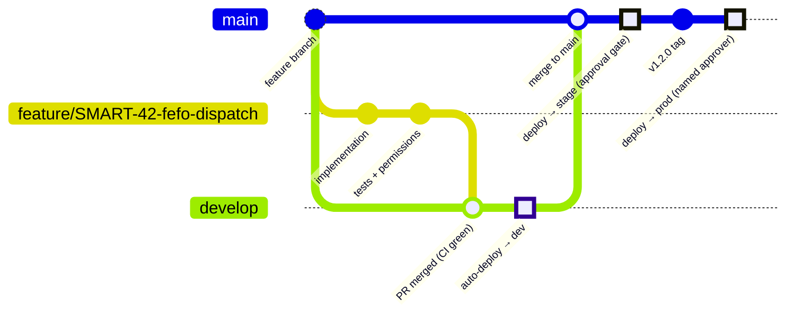

**CI jobs on every PR:**

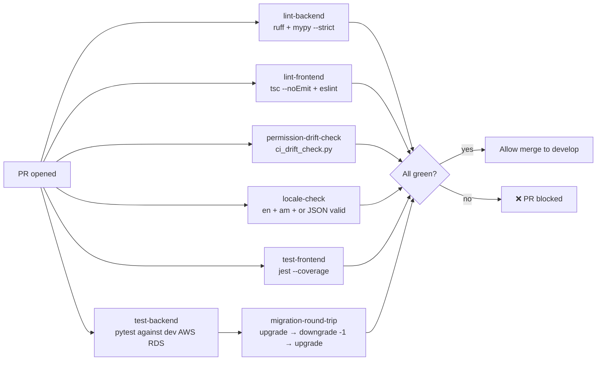

---

## Repository Structure

```
smart-platform/
├── .github/
│   ├── workflows/          # ci.yml · deploy-dev · deploy-staging · deploy-prod
│   ├── PULL_REQUEST_TEMPLATE.md
│   └── CODEOWNERS          # Extra review: permissions/ and migrations/
│
├── frontend/               # Next.js 14 App Router PWA
│   ├── src/
│   │   ├── app/            # Pages (dashboard/inventory, products, reports...)
│   │   ├── components/     # ui/ (Button, Card, Badge) · features/ (scanner, inventory)
│   │   ├── hooks/          # useAuth · usePermission · useOfflineSync · useScanner
│   │   ├── lib/            # api · auth · i18n · scanner · permissions · utils
│   │   └── store/          # offlineQueue.ts (IndexedDB)
│   └── public/sw.js        # Service worker — cache shell + locales, queue offline POSTs
│
├── backend/
│   ├── shared/             # Editable installs — all services depend on this
│   │   ├── permissions/    # registry.py (115 actions) · middleware · audit · casbin
│   │   ├── db/             # session · rls · models (Tenant, User, Product, Inventory...)
│   │   ├── outbox/         # writer · worker (Celery) · notify (pg_listen) · schemas
│   │   └── utils/          # idempotency · pagination · responses
│   │
│   ├── services/           # 10 FastAPI microservices (each with Dockerfile)
│   │   ├── api-gateway/    # JWT validation, rate limiting, proxy
│   │   ├── auth-service/   # Cognito ↔ SMART JWT exchange
│   │   ├── tenant-service/ # Tenant CRUD + onboarding wizard
│   │   ├── product-service/# Products + pg_trgm SKU search
│   │   ├── inventory-service/ # Ledger · dispatch · state machines · cycle count
│   │   ├── order-service/
│   │   ├── logistics-service/
│   │   ├── analytics-service/ # AI pipeline — READ REPLICA ONLY
│   │   ├── notification-service/ # Celery outbox handlers
│   │   └── sync-service/   # Offline conflict resolution
│   │
│   └── migrations/         # Alembic — shared across all services
│       └── versions/001_initial_schema.py  # Phase 0 — all required tables
│
├── locales/                # Language packs — uploaded to S3
│   ├── en.json             # English (default)
│   ├── am.json             # Amharic (አማርኛ)
│   └── or.json             # Oromifa (Afaan Oromoo) — needs native speaker review
│
├── infra/terraform/
│   ├── modules/            # ecs · rds · elasticache · cognito · s3 · networking · observability
│   ├── envs/dev|stage|prod/
│   └── backend.tf          # Remote state: S3 + DynamoDB locking
│
├── scripts/
│   ├── seed_permissions.py   # Seeds all 115 actions from registry.py → role_permissions table
│   ├── ci_drift_check.py     # Fails CI if any route lacks @require_permission
│   └── create_partitions.py  # Monthly inventory_transactions partitions
│
└── CLAUDE.md               # Implementation prompt — PRD v4.0
```

---

## Phase Roadmap

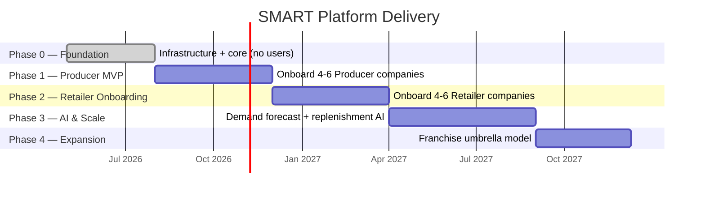

---

## Tech Stack

| Layer | Technology |
|---|---|
| **Frontend** | React 18 · Next.js 14 (App Router) · TypeScript 5 strict · Tailwind CSS 3 · PWA |
| **Scanning** | @zxing/browser — Code128 / EAN-13 / QR / DataMatrix — < 1s P90 |
| **Offline** | Service Worker · IndexedDB (idb) · sync-service conflict resolution |
| **i18n** | English · Amharic (አማርኛ) · Oromifa (Afaan Oromoo) — S3-hosted JSON packs |
| **Backend** | Python 3.12 · FastAPI · SQLAlchemy 2.x async · Pydantic v2 · Alembic |
| **Permissions** | Casbin RBAC + ABAC · 115 actions · 3-layer enforcement |
| **Async** | Transactional Outbox (PostgreSQL NOTIFY + Celery) — **no Kafka** |
| **Database** | Amazon RDS PostgreSQL 16 (primary + read replica) · pg_trgm · RLS |
| **Cache** | Amazon ElastiCache for Redis — Celery broker · session · AI forecast cache |
| **Identity** | AWS Cognito |
| **Infrastructure** | AWS ECS Fargate · Terraform · 3 environments (dev / stage / prod) |
| **Secrets** | AWS Secrets Manager — injected at ECS startup. No `.env` files. |
| **Observability** | Amazon Managed Prometheus · Amazon Managed Grafana · AWS X-Ray (ADOT) · CloudWatch |
| **CI/CD** | GitHub Actions · OIDC auth (no long-lived credentials) |
| **Search** | pg_trgm (default) · Amazon OpenSearch (conditional — explicit tenant request only) |

---

## Demo Application

The frontend demo runs at **http://localhost:3000** (start with `cd frontend && pnpm dev`).

### Demo tenants & login credentials

#### Addis Water (Bottled Water Producer — `addis-water`)

| Email | Password | Role | Facility |
|---|---|---|---|
| admin@addis-water.com | AddisWater@2026 | TA | All |
| production@addis-water.com | AddisWater@2026 | NM | Main Production Center (MWH) |
| regional@addis-water.com | AddisWater@2026 | RM | All facilities |
| logistics@addis-water.com | AddisWater@2026 | LM | All facilities |
| north.wm@addis-water.com | AddisWater@2026 | WM | North WH (RWH) |
| northsub.wm@addis-water.com | AddisWater@2026 | WM | North-Subcenter WH |
| south.wm@addis-water.com | AddisWater@2026 | WM | South WH |
| east.wm@addis-water.com | AddisWater@2026 | WM | East WH |
| west.wm@addis-water.com | AddisWater@2026 | WM | West WH |

#### Muger Cement (Cement Manufacturer — `muger-cement`)

Org hierarchy:
```
Harar Production Center (MWH)
  └── Dire Dawa Regional WH (RWH)
        └── Hawassa WH (WH)

Ambo Production Center (MWH)
  ├── Kombolcha WH (WH)
  └── Mekele WH (WH)
```

| Email | Password | Role | Facility | Sees transfers involving |
|---|---|---|---|---|
| admin@muger-cement.com | MugerCement@2026 | TA | All | All |
| harar.pm@muger-cement.com | MugerCement@2026 | NM | Harar MWH | Harar + Dire Dawa + Hawassa |
| ambo.pm@muger-cement.com | MugerCement@2026 | NM | Ambo MWH | Ambo + Kombolcha + Mekele |
| regional@muger-cement.com | MugerCement@2026 | RM | All facilities | All |
| logistics@muger-cement.com | MugerCement@2026 | LM | All facilities | All |
| diredawa.wm@muger-cement.com | MugerCement@2026 | WM | Dire Dawa RWH | Dire Dawa + Hawassa |
| hawassa.wm@muger-cement.com | MugerCement@2026 | WM | Hawassa WH | Hawassa only |
| kombolcha.wm@muger-cement.com | MugerCement@2026 | WM | Kombolcha WH | Kombolcha only |
| mekele.wm@muger-cement.com | MugerCement@2026 | WM | Mekele WH | Mekele only |

#### System Administrator

| Email | Password | Role |
|---|---|---|
| smartadmin@smart-inventory.com | SmartAdmin@2026 | SA |

### IMTS Transfer workflow

| Transfer Type | Initiator | From field | To field |
|---|---|---|---|
| **PULL** | Any WH (requesting stock) | Selectable source (MWH/RWH) | **Auto-locked to user's WH** |
| **PUSH** | MWH / RWH only | **Auto-locked to user's facility** | Selectable destination |
| **SISTER** | Any WH (lateral) | **Auto-locked to user's WH** | Selectable same-level WH |

WM at WH/SUB_WH level: PULL and SISTER only. NM at MWH, RM, LM: all types including PUSH.

### Transfer state machines

```
PULL:   DRAFT → PENDING_REVIEW → PENDING_APPROVAL → APPROVED → ISSUED → IN_TRANSIT → [PARTIALLY_RECEIVED] → RECEIVED → COMPLETED
PUSH:   DRAFT → PENDING_APPROVAL → APPROVED → [ADVISED] → ISSUED → IN_TRANSIT → [PARTIALLY_RECEIVED] → RECEIVED → COMPLETED
SISTER: DRAFT → PENDING_SOURCE_CONFIRM → PENDING_DEST_CONFIRM → PENDING_APPROVAL → APPROVED → ISSUED → IN_TRANSIT → [PARTIALLY_RECEIVED] → RECEIVED → COMPLETED
```

### Inventory visibility (hierarchy-scoped)

| Role | Sees in Transfers page |
|---|---|
| TA / SA | All transfers |
| RM / LM | All transfers |
| NM at MWH | All transfers (apex of supply hierarchy) |
| WM at RWH | Own RWH + all descendant WHs |
| WM at WH/SUB_WH | Only transfers involving their warehouse |

Completed, Cancelled, and Rejected transfers are archived to the **Audit Log** page.

### Audit Log

Every transfer transition, stock receive, and issue is recorded in the Audit Log with separate columns for: product name, quantity/unit, From warehouse, To warehouse. Data persists to `localStorage` across refreshes and logins.

---

## Getting Started

> There is no local development environment. All SDLC environments run on AWS ECS Fargate.

### Prerequisites

```
python 3.12 · uv · node 20 · pnpm · aws-cli v2 · terraform
GitHub access to smart-platform repo
AWS IAM identity with dev environment permissions (provisioned by Tech Lead via Terraform)
```

### Developer workflow

```bash
# 1. Authenticate to AWS dev environment
aws sso login --profile smart-dev

# 2. Create a feature branch
git checkout develop
git pull
git checkout -b feature/SMART-<n>-<slug>

# 3. Write code + tests (IDE only — no local services)

# 4. Run unit tests locally (no AWS services needed)
cd backend/shared && uv pip install -e ".[test]"
pytest backend/ -v -m "unit" --tb=short

# 5. Push → GitHub Actions CI runs automatically against dev AWS
git push -u origin feature/SMART-<n>-<slug>

# 6. Open PR → review CI results → address feedback → merge to develop
# Merge to develop → auto-deploys to dev environment
```

### Key absolute constraints

- **Never** build separate codebases for producers vs retailers
- **Never** update stock balances directly — all mutations `INSERT` into `inventory_transactions`
- **Never** ship a new endpoint without `@require_permission` and `registry.py` entry
- **Never** run analytics queries on the primary database — read replicas only
- **Never** allow AI recommendations to auto-execute — status must be `PENDING_APPROVAL`
- **Never** use Kafka, RabbitMQ, or aiokafka — async uses the Outbox Pattern
- **Never** hardcode English text in JSX — all UI strings use `t()` i18n keys
- **Never** commit secrets, `.env` files, or connection strings

---

*SMART Inventory — PRD v4.0 · Python 3.12 / FastAPI · Next.js 14 / TypeScript · AWS ECS Fargate · Terraform*
*Languages: English · Amharic (አማርኛ) · Oromifa (Afaan Oromoo)*
*Last updated: May 2026 — IMTS enhancements: org hierarchy, type-specific state machines, audit log, partial receive*
